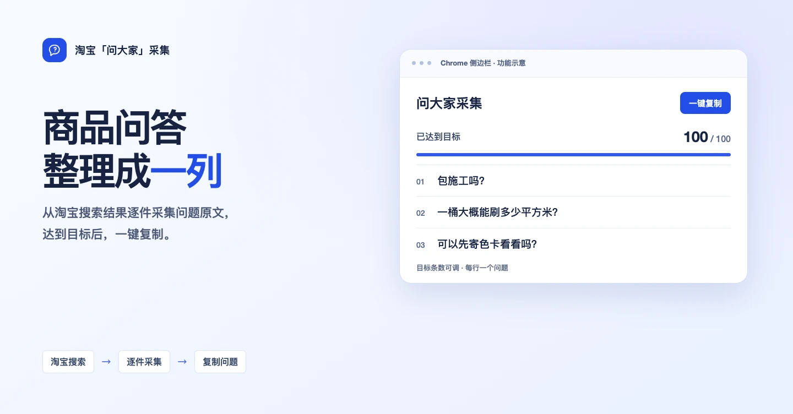

# 淘宝「问大家」采集

一个桌面 Chrome 扩展，把淘宝和天猫商品「问大家」中的问题原文整理成一列。你选好搜索词和销量排序，扩展按页面顺序逐件采集，达到目标后可以一键复制。

**[下载 Chrome 扩展 v0.2.0（ZIP）](https://github.com/Xx-otaku/tao-questions/releases/download/v0.2.0/tao-questions-v0.2.0.zip)**

[安装](#安装) · [开始采集](#开始采集) · [遇到暂停怎么办](#遇到暂停怎么办)

## 安装

需要 **桌面版 Chrome 116+**。扩展可以直接从源码加载。

1. 点击顶部的 **下载 Chrome 扩展 v0.2.0（ZIP）**，然后解压。
2. 在 Chrome 地址栏输入 `chrome://extensions`，打开右上角的「开发者模式」。
3. 点击「加载已解压的扩展程序」，选择含有 `manifest.json` 的解压目录。
4. 从 Chrome 工具栏的扩展菜单打开「问大家采集」。常用的话，可以把它固定到工具栏。

## 开始采集

1. 在 Chrome 登录淘宝，搜索商品，在结果页选择「销量」排序。
2. 打开扩展侧边栏，设置目标条数。默认是 **100**，点击「开始」。
3. 扩展保留搜索页，在另一个可见标签页依次打开商品，读取「查看全部问答」里的问题。当前结果页处理完且数量不足时，会尝试继续翻页。
4. 顶部点击「一键复制」，把已采到的问题粘贴到表格或笔记。**每行一个问题**，采集中也可以复制。

普通商品和广告商品都按页面顺序处理。没有「问大家」的商品会跳过，同一商品只处理一次，不同条提问即使同文也分别保留。结果只包含问题正文。

项目曾用「水包砂外墙漆」搜索结果进行真实浏览器验收，侧边栏达到 `100 / 100`，复制出的 100 行与列表逐行一致。每次能读到多少条取决于当前搜索结果和淘宝页面的可见内容。

## 按商品筛选问题

新版按来源商品分组，组标题取自商品详情页上可见的主标题。点击组标题可在新标签页打开商品详情。发现搜索结果里混入不相关商品时，点击对应分组的「删除本商品问题」。确认后整组会从列表和复制结果中移除，正在运行的采集会暂停。

需要凑够原目标时，点击「继续补采」。本次任务不会再采集已删除的商品。顶部的「一键复制」仍只复制问题正文，每行一条。旧版只有问题原文的记录会保留在「旧版记录 · 无来源」中。已记录商品链接但标题来源未核实的分组显示「商品标题待核实」。

## 遇到暂停怎么办

| 提示 | 如何继续 |
| --- | --- |
| 请确认销量排序 | 回到搜索结果确认已按销量排序，再在侧边栏确认。 |
| 需要登录或验证 | 在淘宝页面完成登录或验证，然后点「继续」。 |
| 页面或问答区域无法识别 | 检查采集标签页是否正常打开。页面加载后再点「继续」，也可以先复制现有结果。 |
| 无法确认原位置 | 先复制已有结果，再回到搜索结果页重新开始。开始新任务前会提示清空旧结果。 |

任务和结果保存在当前浏览器。浏览器重启或扩展重新加载后，重新打开侧边栏即可查看已有进度。搜索结果耗尽时会保留已经采到的条目。

## 实现与数据

扩展采用 Manifest V3 和原生 JavaScript，从淘宝、天猫页面读取当前已登录用户可见的内容。任务与问题存入 `chrome.storage.local`，不需要配置服务器，也不需要把 Cookie 交给扩展。侧边栏与当前采集任务共用同一份本地进度。
